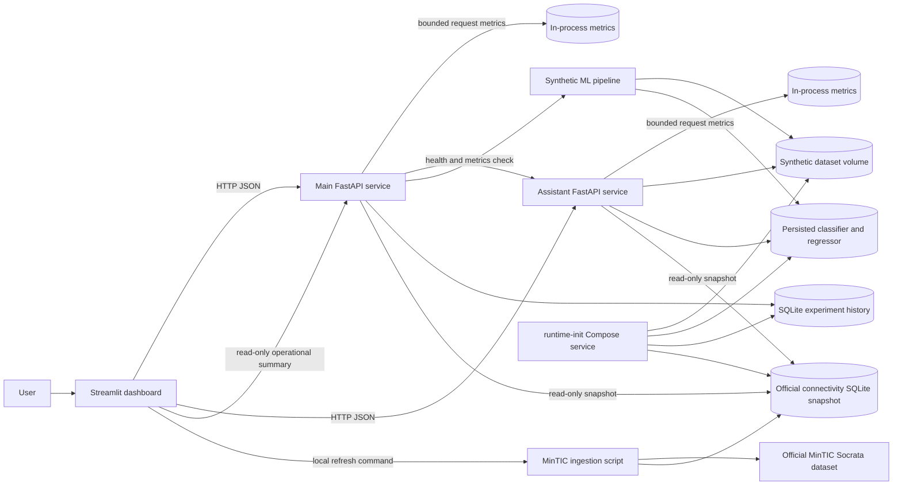

# System architecture

## Components



The diagram shows data and request responsibilities, not current process health. Docker Compose starts `runtime-init` once, then starts the main API and assistant API after initialization completes. The dashboard waits for both APIs to pass their configured `/ready` health checks. Named volumes preserve generated datasets, model artifacts, reports, experiments, and the optional official-data snapshot.

## Responsibilities

- **Streamlit dashboard:** Presents the synthetic prediction and analysis workflows, saved experiments, assistant interface, and the optional Real Connectivity Intelligence section. It calls both FastAPI services over HTTP.
- **Main FastAPI service:** Serves synthetic predictions, model metadata, experiments, and read-only MinTIC analytics. Its `/ready` check verifies required runtime data/model assets are usable.
- **Assistant API:** Provides deterministic, tool-grounded chat and allowlisted dataset queries. It does not use an LLM. Its `/ready` check verifies its required synthetic data and model artifacts.
- **Synthetic ML pipeline:** Creates synthetic WiFi-demand data, prepares features, trains/evaluates the classifier and regressor, and persists their artifacts and diagnostics. Prediction APIs load those persisted models; they do not train models per request.
- **Official MinTIC ingestion:** `scripts/refresh_official_data.py` obtains the official fixed-internet dataset, validates/normalizes the municipality records, records provenance, and stores a local SQLite snapshot. Refresh is explicit/on demand; the source is not polled continuously.
- **SQLite persistence:** The experiment database stores saved synthetic scenario runs. A separate SQLite database stores raw and normalized MinTIC source records, validation, batch provenance, and refresh history. These datasets are not joined into ML training or predictions.
- **Docker Compose:** `runtime-init`, `main-api`, `assistant-api`, and `dashboard` are separate services. The three long-running services have HTTP health checks; Compose dependencies gate startup on runtime initialization and API readiness.
- **Operational observability:** Shared API middleware records bounded per-service request counts, HTTP response statuses, error counts, and monotonic durations in process memory. It stores no request content or sensitive headers. The dashboard reads a diagnostics summary through the main API, which probes the assistant using its health and metrics routes.

## Main data flows

1. **Synthetic prediction:** `runtime-init` creates the synthetic dataset and persisted model/report assets. The dashboard sends a scenario to the main API, which loads the persisted models and returns a prediction with traceability. Synthetic predictions and evaluation metrics do not validate real WiFi demand in Tunja.
2. **Assistant request:** The dashboard sends a chat or structured query to the assistant API. The deterministic assistant routes the request through existing tools and reads synthetic dataset/model resources as needed.
3. **Official connectivity:** An operator explicitly runs the refresh script. Validated source rows and provenance are persisted locally. The dashboard and both APIs read the local snapshot for municipal descriptive analysis, exports, period comparison, quality diagnostics, and provider concentration. Cached/stale snapshots are identified separately from live source access.

## API communication and health

The dashboard uses `MAIN_API_URL` (default `http://127.0.0.1:8000`) and `ASSISTANT_API_URL` (default `http://127.0.0.1:8001`) to communicate with the APIs. In Compose, service DNS names are used for these URLs. `/health` indicates that an API process responds; `/ready` checks required runtime assets. A health response alone does not establish model quality or real-world validity.

V7.6.0 adds `GET /architecture/diagnostics` to the main API. The endpoint reports component responsibilities with the result and scope of each available check. It does not inspect a Docker daemon. Unconfigured or unreachable dependencies are shown as unverified/unavailable, separate from a verified not-ready or failed check. It omits filesystem paths, credentials, and environment-variable values. The dashboard marks its own status only while its diagnostics section is rendering.

V7.7.0 operational observability flow: each API's shared middleware records its route-template, status, error count, and duration in a bounded in-process registry. `GET /observability/diagnostics` returns the main API metrics and checks assistant availability/readiness without exposing its URL. The existing dashboard presents a compact summary and labels an unavailable probe as unknown. Counters reset when a service restarts; they are not durable monitoring or an alerting system. Synthetic ML records and official MinTIC analytics remain separate.

## Data boundaries

Synthetic access points, locations, demand observations, model features, training labels, fitted model artifacts, predictions, and scenario results remain synthetic. MinTIC records are official descriptive fixed-internet subscription/access counts at Tunja municipal and quarterly granularity. They are persisted separately and are not inputs to the synthetic ML training or predictions. The official source does not measure public WiFi traffic, coverage, service quality, congestion, or saturation.

## Historical architecture and implementation notes

V6.1 adds a pure integer allocation optimizer to the existing scenario workbench. The main API orchestration obtains fixed regressor predictions and records allocation results in the current SQLite experiment JSON; no new service, database, table, model fit, or model artifact change is introduced. Shared JSON/Markdown reports expose schema 1.3 and tolerate historical records without optimization metadata. The Streamlit workbench offers comparison and optimization flows in the same section. Product release V6.1.0 is published as tag `v6.1.0`; package and Docker image versions are `0.6.1`. See the [optimization guide](optimization.md), [API reference](api.md), and [V6.1 validation record](releases/v6.1.0.md).

V6.2.0 extends the same workbench with bounded sensitivity analysis over saved optimization runs. It reuses stored synthetic demand and the V6.1 optimizer, persisting additive result JSON in the current SQLite store; it adds no table, migration, model fit, or model artifact. Report schema 1.4 exposes the optional analysis and reads historical records. Product V6.2.0 is published as tag `v6.2.0`; package and Docker image versions are `0.6.2`. See the [V6.2.0 validation record](releases/v6.2.0.md). See [sensitivity and robustness](robustness.md) and the [API reference](api.md).

Scenario experiment flow: dashboard/API request → existing `ScenarioPredictionService` for each synthetic zone → deterministic capacity allocation and aggregate metrics → SQLite transaction → compatible comparison and report serialization. The experiment database is initialized by `runtime-init`; no model training or model artifact mutation occurs inside scenario requests.

**The dataset is synthetic and was generated for software development, machine learning experimentation, demonstration, and portfolio purposes.** Coordinates and access-point identifiers do not correspond to real public WiFi infrastructure in Tunja.

Runtime and development dependency declarations live in `pyproject.toml`. `requirements.lock` is generated from the runtime dependencies for Python 3.12/Linux x86-64 and installed with hash verification in the image. Compose pins `linux/amd64`; local development supports Python 3.11+ and installs the `dev` extra without using the container-only lock.

## ASCII diagram

```
                    +------------------------------+
                    | scripts/generate_synthetic_  |
                    | dataset.py  (seed=42)        |
                    +--------------+---------------+
                                   | CSV
                                   v
                    data/raw/wifi_tunja_public.csv
                                   |
          +------------------------+------------------------+
          |                        |                        |
          v                        v                        v
   scripts/prepare_data.py   notebooks (EDA)         tests (fixtures)
          | load / validate / dedupe / engineer
          v
   data/processed/*.csv
          |
          v
   scripts/train_model.py
          | temporal split -> sklearn Pipeline fit on TRAIN only
          v
   models/wifi_demand_classifier.joblib + wifi_demand_regressor.joblib
          |                          \
          v                           v
   scripts/evaluate_model.py    src/.../models/predict.py
          | reports/                   |
          v                    +-------+--------+
   reports/metrics, figures    |                |
                               v                v
                         api/ (FastAPI)   app/dashboard.py
                               |                |
                               + assistant_api/ + tests/
```

## Layers

### Data layer (`src/wifi_tunja_smart_predictor/data/`)

- `loader.py` locates the CSV from the repository root and parses timestamps.
- `validator.py` separates **expected** quality issues (generator-injected missingness and a few duplicates) from **critical** contract violations (missing schema, invalid targets, unparsable timestamps).

### Feature engineering layer (`features/engineering.py`)

- Cyclical calendar encodings and prediction-time ratios.
- Implemented as a stateless sklearn transformer so the same code is persisted with the model.
- Never reads `demand_level` or `connections_next_hour`.

### Preprocessing layer (`preprocessing/pipeline.py`)

- `ColumnTransformer`: median imputation + optional scaling for numerics; most-frequent imputation + `OneHotEncoder(handle_unknown="ignore")` for categoricals.
- Fitted only after the temporal split, on training rows.

### Model layer (`models/train.py`, `models/regression.py`, `models/evaluate.py`)

- Five baseline classifiers with bounded hyperparameters.
- Comparison table written to `reports/metrics/model_comparison.csv`.
- Selection uses **validation F1** for class `HIGH`. Test metrics are reported for all models and are not used for selection.
- Separate next-hour connection regressors are selected by validation MAE and persisted with independent metadata.
- A split-conformal interval uses validation absolute residuals; test coverage is reported separately.

### Inference layer (`models/predict.py`)

- `load_model`, `predict_demand`, `predict_probability`.
- Shared by FastAPI and Streamlit.

### API layer (`api/`)

- The original `/health`, `/model-info`, and `/predict` contracts remain available; V3 adds `/locations` and `/scenario/predict`.
- OpenAPI at `/docs`.

### Dashboard layer (`app/dashboard.py`)

- Overview, scenario prediction, demand explorer, geographic analysis, network analysis, model performance, assistant, advanced prediction, and about.
- Location/time scenario construction runs through shared package services. Frames and model resources are cached.

### Assistant layer (`assistant/`, `assistant_api/`)

- Deterministic intent routing invokes fixed prediction, location, model metadata, and aggregate-query tools.
- Dataset queries use strict allowlists; assistant input is never executed as code or SQL.
- Session context is bounded, process-local, and non-durable.

### Testing layer (`tests/`)

- Fast unit tests with in-memory frames. CI does not train on 60,000 rows.

## End-to-end flow

1. Generate the immutable source CSV with `scripts/generate_synthetic_dataset.py`.
2. `scripts/prepare_data.py` validates it, removes exact duplicates in a derived copy, and writes processed data.
3. `scripts/train_model.py` splits chronologically, fits candidate pipelines on train, chooses by validation F1, and writes the selected artifact and metadata.
4. `scripts/evaluate_model.py` evaluates the saved artifact on the held-out test period and writes metrics and figures.
5. Scenario APIs, dashboard, and assistant use the same scenario builder and model service. Tests use small in-memory data and injected models.

## Modeling location of identifiers

`wifi_id`, `zone_id`, and `zone_name` are **not** model inputs. `zone_name` is a one-to-one proxy for `zone_id` and would act as a location dummy. **`zone_type`** is used instead: it describes synthetic land use and can generalise across access points.

## Runtime resource reuse (V3.6)

The API and dashboard retain their existing bounded service/model/data caches. The assistant owns one normalized `DatasetQueryEngine` and the dataset query route reuses it; it does not rebuild a full frame for each request. Scenario construction computes deterministic analog feature baselines alongside the scenario features, and the explanation step consumes those values rather than reselecting analog rows from a copied historical frame. No prediction model, features, endpoint schema, or dashboard behavior changed. See [performance notes](performance.md).

## Local container topology and runtime resources (V3.9 implementation)

```text
docker compose up --build
          |
          v
 runtime-init (only for empty named volumes)
   generate → prepare → train existing pipeline
          |
     successful exit
       /       \
      v         v
 main-api    assistant-api
   |  \          |
   |   \         | /chat
   |    v        v
   +-- dashboard (server-side Compose DNS clients)

runtime-data, runtime-models, runtime-reports
       initialized once, mounted read-only by app services
```

The initializer refuses to overwrite a partially initialized volume and validates complete existing model bundles before reuse; invalid artifacts fail initialization without being replaced. A failed initialization blocks API and dashboard startup; its stage output is available with `docker compose logs runtime-init`. Normal `docker compose down` preserves generated volumes and avoids retraining on the next start. `docker compose down -v` removes the Compose project's generated volumes for an explicit synthetic-data reset. See [deployment](deployment.md) for commands and failure recovery.

Both APIs retain `/health` as a process liveness check. `/ready` checks required datasets, model and metadata files, comparison reports, deserialization of both models, and consistency of model versions and feature metadata. `/model-info` separates the application package version from the classifier artifact version. Compose starts APIs after initialization succeeds and the dashboard only after both APIs pass readiness. A separate standard-library smoke script exercises the real HTTP APIs from the dashboard container's network context. This setup remains a local synthetic demonstration and does not imply real-world forecast validity.

## Observability (V3.7)

Both FastAPI services install the shared request observability middleware outside the existing body-limit, security-header, and CORS middleware. It validates or generates a request ID, places it in a request-scoped context, returns it in `X-Request-ID`, and emits one monotonic-timed lifecycle event. API routes and the assistant service emit safe business-operation events using that context. The shared formatter writes JSON records; no request body or conversation is persisted. See [observability](observability.md).
